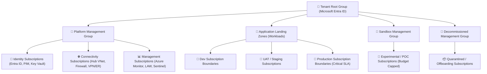
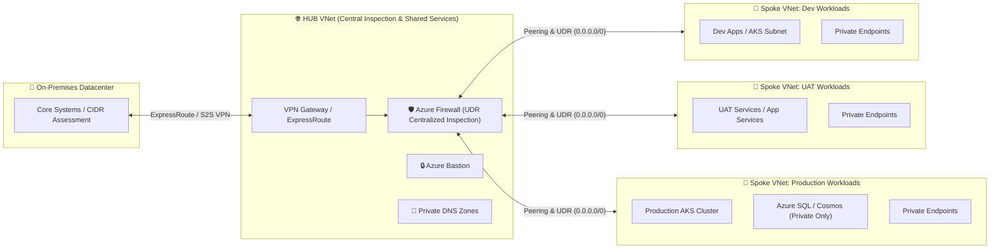
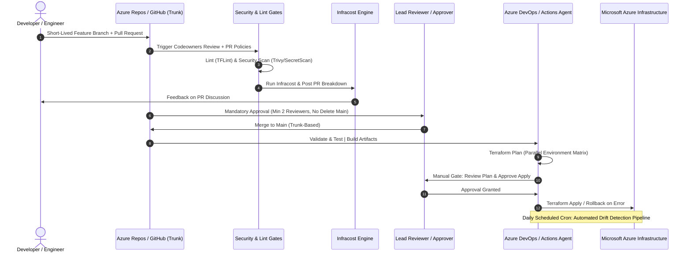
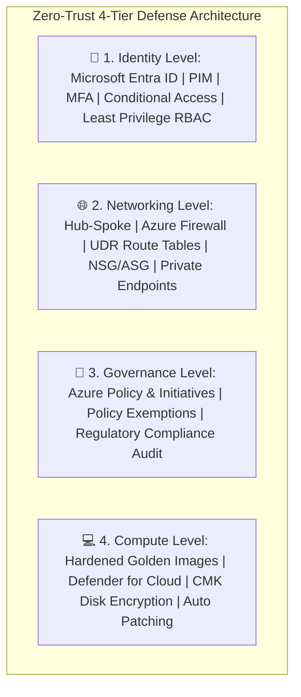
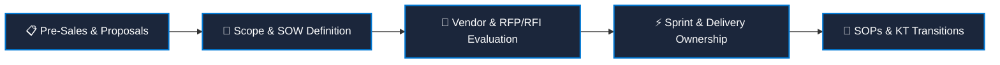

<!-- HERO HEADER BANNER -->

# ⚡ Simran Kamble
### **Engineering Enterprise Cloud Foundations, Scalable Landing Zones & Automated DevSecOps Pipelines**

  <em>Enterprise Cloud Architect & DevSecOps Engineer with 3+ Years of Hands-on Experience Architecting Resilient Azure Infrastructure, Zero-Trust Governance & Seamless 100+ Multi-App Migrations</em>

<!-- SOCIAL & PROFESSIONAL BADGES -->

  
  
  
  

<!-- QUICK PILL BADGES -->

  
  
  
  
  
  
  

---

## 📌 Executive Profile

Dynamic and results-driven **DevOps & Cloud Infrastructure Engineer** with **3+ years of enterprise experience** specializing in end-to-end Microsoft Azure infrastructure provisioning, enterprise Landing Zone implementation (CAF), shift-left DevSecOps CI/CD automation, and large-scale application modernizations.

Proven track record of architecting and orchestrating **100+ complex multi-tier enterprise workload migrations** across On-Premises Datacenters and multi-subscription Azure cloud environments (Dev, UAT, Production). Expert in building **zero-trust Hub-and-Spoke topologies**, automated **Terraform modules with drift detection**, enterprise **Kubernetes (AKS)** environments, and driving **FinOps cost-reduction initiatives** while maintaining strict 99.99% High Availability and regulatory compliance.

### 🎯 Key Engineering Milestones
- 🏗️ **Enterprise Landing Zones**: Architected Management Group and Subscription hierarchies aligned with the Microsoft Cloud Adoption Framework (CAF) across Platform, Sandbox, and Application Landing Zones.
- 🚀 **100+ Enterprise App Migrations**: Spearheaded discovery, assessment, dependency mapping, cutover checklists, and hypercare for 100+ applications across Dev, UAT, and Prod.
- ⚡ **Zero-Trust DevSecOps**: Implemented trunk-based CI/CD pipelines in Azure DevOps & GitHub Actions with automated code analysis, container scanning, secret detection, and Infracost gates.
- 🌐 **Hub-and-Spoke Networking**: Built secure perimeter networks with Azure Firewall, User Defined Routes (UDRs), Private Endpoints, and ExpressRoute/VPN connectivity.
- 💰 **FinOps & Cost Governance**: Reduced cloud expenditure by over 30% through automated VM scheduling, orphan resource remediation, unattached disk cleanup, and Reserved Instances optimization.
- 🔄 **99.99% HA & BCDR**: Enforced rigorous RTO/RPO objectives with Azure Site Recovery (ASR), GRS/ZRS storage policies, and Virtual Machine Scale Sets (VMSS).

---

## 🏛️ Enterprise Cloud Architecture & Landing Zones (CAF)

Architected scalable, compliant, and secure multi-tenant foundations adhering strictly to the **Microsoft Cloud Adoption Framework (CAF)** lifecycle: **Plan ➔ Ready ➔ Adopt ➔ Govern ➔ Secure ➔ Manage**.

### 1. Management Group & Tenant Hierarchy

### 2. Tenant Hierarchy & Identity Best Practices
| Component | Enterprise Implementation Strategy | Security & Governance Control |
| :--- | :--- | :--- |
| **Tenant Boundaries** | Isolated subscription pools separating Platform Services from Business Application Landing Zones. | Enforced blast-radius containment across Dev, UAT, and Production. |
| **Entra ID & Identity** | Centralized User/Group management, Dynamic Security Groups, and Conditional Access policies. | Zero standing access; Just-In-Time (JIT) access via Privileged Identity Management (PIM). |
| **Azure Policy & Initiatives** | Custom initiative definitions enforcing tagging, permitted regions, and encryption at rest. | Automated guardrails blocking non-compliant resource creation with audit logging. |
| **Policy Exemptions** | Formal exemption lifecycle backed by documented justifications and expiration timestamps. | Regular compliance auditing; automated alerting on expiring policy waivers. |
| **RBAC Group Formulation** | Role assignments mapped exclusively to Entra ID Security Groups rather than individual identities. | Principle of Least Privilege (PoLP) strictly enforced across all scopes. |
| **Subscription Lifecycle** | Standardized automated onboarding and offboarding workflows with automated resource sanitization. | Automated orphan asset discovery and baseline policy attachment. |

---

## 🌐 Hub-and-Spoke Networking & Traffic Inspection

Architected resilient, secure network topologies with centralized egress, East-West inspection, and zero public IP exposure for backend workloads.

### Network Architecture Specifications
- **IP Address Management (IPAM) & CIDR Assessment**: Performed complete on-premises subnet analysis to prevent CIDR overlapping during hybrid interconnection.
- **Hub VNet Standards**: Houses ExpressRoute/VPN Gateways, Azure Firewall Premium with TLS inspection, Azure Bastion, and centralized Private DNS Resolver.
- **Spoke VNet Peering & User Defined Routes (UDRs)**: Configured custom route tables overriding `0.0.0.0/0` to force all egress and spoke-to-spoke traffic through the Azure Firewall.
- **Private Endpoints & DNS Integration**: All PaaS services (Azure Storage, Key Vault, Azure SQL, ACR) provisioned with Private Endpoints, eliminating public exposure.
- **Controlled Egress & Shared Connectivity**: Application workloads reach external dependencies strictly through application and network firewall rule collections.

---

## ⚡ DevSecOps & Infrastructure as Code (IaC)

### 1. Terraform Landing Zone Automation & Engineering Standards
- **Remote State Management**: State hosted securely in Azure Blob Storage with customer-managed keys (CMK), state locking via Azure Blob Leases, and strict RBAC lockdown.
- **Modular Architecture**: DRY-compliant, reusable, versioned modules for networking, AKS, storage, compute, and policy assignments.
- **Shift-Left Security & Linting**: Integrated static analysis (`tflint`, `terraform fmt`), secret scanning (`gitguardian`), and vulnerability auditing (`tfsec`, `trivy`).
- **Cost Estimation**: Automated pull request cost breakdown comments via `Infracost` prior to pipeline approval.
- **Drift Detection Pipelines**: Scheduled daily cron pipelines running `terraform plan -detailed-exitcode` to catch and notify of out-of-band portal changes.

### 2. Enterprise DevSecOps CI/CD Pipeline Lifecycle

### 3. Pipeline Governance & Branching Policies
- **Trunk-Based Branching Model**: Short-lived feature branches merged frequently into `main` after automated validation.
- **Branch Protection Policies**: Enforced pull requests with mandatory code reviews (min 2 reviewers), Code Owners approval, successful status checks, and linear git history. Branch deletion protections strictly enabled on `main`.
- **Modular Pipeline Templates**: Shared YAML templates across repositories covering `Validate`, `Test`, `Build`, `Deploy`, `Apply`, and automated `Rollback`.
- **Parallel Pipeline Jobs**: Optimized build and test runtimes via parallelized jobs across multiple regions and stages.
- **Middleware Automation**: Automated VM bootstrapping and middleware provisioning utilizing custom data scripts, Cloud-init, and Azure VM Custom Script Extensions.

---

## 🐳 Containerization & Kubernetes (AKS)

- **Docker Containerization**: Crafted production-grade Dockerfiles using multi-stage builds, minimal base images (Alpine/Distroless), non-root execution, and image signing.
- **Azure Kubernetes Service (AKS)**:
  - Managed system and user node pools with Virtual Machine Scale Sets (VMSS) and auto-scaler enabled.
  - Azure CNI networking with Calico network policies for micro-segmentation.
  - Ingress Controllers (NGINX / Azure Application Gateway Ingress Controller - AGIC) configured with automated TLS cert-manager.
  - Azure Key Vault Secrets Store CSI Driver integration for zero-hardcoded-secret pod deployments.
  - Container vulnerability scanning integrated into CI/CD via Trivy and Microsoft Defender for Containers.

---

## 🚀 100+ Enterprise Application Cloud Migration

Executed structured migration and application modernization programs migrating **100+ multi-tier workloads** from On-Premises Datacenters to Azure across **Dev, UAT, and Production** subscriptions.

```mermaid
flowchart LR
    subgraph Discovery["1. Discovery & Assessment"]
        D1["Inventory Discovery<br/>(Azure Migrate)"]
        D2["On-Premises CIDR &<br/>Dependency Mapping"]
        D3["6R Strategy<br/>(Rehost, Replatform, Refactor)"]
    end

    subgraph Readiness["2. Landing Zone Readiness"]
        R1["Multi-Sub Provisioning<br/>(Dev / UAT / Prod)"]
        R2["Hub-Spoke Network &<br/>Firewall Readiness"]
        R3["Entra ID & RBAC Roles"]
    end

    subgraph Cutover["3. Migration & Cutover"]
        C1["Data Replication Sync<br/>(ASR / DMS)"]
        C2["Pre-Cutover Checklist<br/>Validation"]
        C3["Zero-Downtime Cutover<br/>& DNS Flip"]
    end

    subgraph Operations["4. Hypercare & FinOps"]
        O1["Post-Cutover Checklist<br/>& Health Checks"]
        O2["Azure Monitor &<br/>KQL Dashboards"]
        O3["24/7 Hypercare &<br/>Final Sign-off"]
    end

    Discovery --> Readiness --> Cutover --> Operations
```

### Migration Checklists & Governance Framework
| Phase | Actionable Checklist Items | Validation Criteria |
| :--- | :--- | :--- |
| **Pre-Migration Checklist** | • Comprehensive dependency mapping via Azure Migrate. • Firewall port opening and network throughput stress tests. • Storage account and replication appliance staging. • Mock cutovers conducted in dedicated UAT landing zones. | 100% dependency closure, latency benchmarking within acceptable threshold. |
| **During Migration Checklist** | • Continuous delta data synchronization. • Application services gracefully stopped on-premise. • Database cutover execution and delta replication validation. • DNS TTL minimization and traffic redirection to Azure endpoints. | RPO near zero; data integrity verification check passed. |
| **Post-Migration Checklist** | • Synthetic health probes and end-to-end user transaction testing. • Verification of backup protection (Azure Backup / ASR replication). • Enable Azure Monitor, Log Analytics agents, and Metric Alerts. • Handover to hypercare operational engineering team. | Sign-off on application performance KPIs, zero Sev-1 incidents. |
| **Hypercare Support** | • Dedicated 2-4 week hypercare stabilization period. • Rapid incident response and performance optimization. • Final Knowledge Transfer (KT) and updated SOP documentation delivery. | Customer stakeholder sign-off and transition to run/managed services. |

---

## 🛡️ 4-Tier Zero-Trust Security & Governance

- **Identity Level**: Microsoft Entra ID enterprise tenant management, role-based access control (RBAC), Just-In-Time (JIT) access through Privileged Identity Management (PIM), and strict Conditional Access policies.
- **Networking Level**: Zero public ingress to application tiers. Perimeter defense via Azure Firewall Premium, isolated subnets with Network Security Groups (NSGs) / Application Security Groups (ASGs), and forced tunneling via UDRs.
- **Governance Level**: Continuous compliance enforcement with Azure Policy initiatives (CIS Benchmarks, ISO 27001). Formal exemption workflows requiring business justification and fixed expirations.
- **Compute Level**: Virtual Machine Scale Sets (VMSS) configured with custom-data bootstrap scripts, disk encryption with customer-managed keys (CMK), Defender for Cloud endpoint detection, and automated patch management.

---

## 💰 FinOps & Cloud Cost Optimization

Implemented comprehensive FinOps best practices across all subscriptions to maintain lean, predictable cloud budgets:

```mermaid
flowchart TD
    FinOps["💡 Enterprise FinOps Strategy"]
    
    FinOps --> Waste["🗑️ Waste Elimination"]
    FinOps --> Sizing["📐 Rightsizing & Compute"]
    FinOps --> Commit["💳 Capacity Commitments"]
    FinOps --> Monitoring["📊 Telemetry & Ingestion"]

    Waste --> W1["Locate & delete unattached managed disks"]
    Waste --> W2["Release orphaned public IPs & idle NICs"]
    Waste --> W3["Clean up aged snapshots and orphan resources"]

    Sizing --> S1["Downsize oversized compute based on 90-day P95 metrics"]
    Sizing --> S2["Automated Start/Stop runbooks for Dev/UAT environments"]
    Sizing --> S3["Elastic VMSS autoscaling on demand"]

    Commit --> C1["1-Year & 3-Year Azure Reserved Instances (RI)"]
    Commit --> C2["Azure Savings Plans for compute flexibility"]
    Commit --> C3["Storage tiering: Hot ➔ Cool ➔ Cold ➔ Archive lifecycle"]

    Monitoring --> M1["Log Analytics data ingestion rate tuning & log filtering"]
    Monitoring --> M2["Backup retention lifecycle adjustment to SLA needs"]
    Monitoring --> M3["Cost allocation tags enforced by Azure Policy"]
```

---

## 🔄 High Availability (HA) & Disaster Recovery (BCDR)

- **Storage Redundancy Strategy**:
  - **LRS (Locally Redundant)**: Dev & ephemeral workloads for maximum cost efficiency.
  - **ZRS (Zone-Redundant)**: Mission-critical databases and shared storage resilient across availability zones within a region.
  - **GRS (Geo-Redundant)**: Compliance backups and disaster recovery payloads replicated asynchronously to paired secondary regions.
- **Compute High Availability**:
  - Virtual Machine Scale Sets (VMSS) deployed across multiple Availability Zones with automatic health repair and auto-scaling rules.
- **Disaster Recovery SLAs**:
  - Architected paired-region replication topologies utilizing **Azure Site Recovery (ASR)**.
  - Enforced contractual **Recovery Time Objectives (RTO)** and **Recovery Point Objectives (RPO)** validated via bi-annual automated failover drills.

---

## 📈 Observability, Monitoring & Operations

- **Azure Monitor & Log Analytics**: Centralized Log Analytics Workspaces (LAW) aggregating system event logs, diagnostic streams, and syslog telemetry.
- **Application Insights**: Deep performance monitoring, live metrics, distributed transaction tracing, and exception tracking for microservices and APIs.
- **KQL (Kusto Query Language) Dashboards**: Custom operational dashboards visualizing resource health, throughput, network latency, and cost trends.
- **Metric Alerts & Action Groups**: Multi-channel alert routing (email, webhooks, ITSM integration) for immediate incident response with automated runbook remediation.

---

## 🤝 Technical Leadership, Vendor & Delivery Governance

Bridging the gap between high-level architectural strategy, technical execution, and commercial governance:

### Governance & Vendor Management Capabilities
- **RFP & RFI Technical Evaluation**: Formulated technical evaluation matrices to rigorously benchmark vendor architecture capabilities, SLA commitments, security maturity, and commercial proposals.
- **Scope of Work (SOW) & Commercials**: Defined unambiguous project scopes, milestones, acceptance criteria, commercial dependencies, risk registers, and contractual payment milestone sign-offs.
- **Sprint Ownership & Delivery**: Drove Agile/Scrum ceremonies, technical task assignments, sprint planning, dependency tracking, and weekly stakeholder retro calls.
- **Escalation Matrix Design**: Formulated multi-tier escalation matrices with clear SLAs for Sev-1 through Sev-4 production incidents, ensuring accountability and fast resolution.
- **Transitions, SOPs & Upskilling**: Authored Standard Operating Procedures (SOPs) and comprehensive disaster recovery runbooks; conducted hands-on technical upskilling workshops for customer engineering teams.

---

## 🛠️ Technical Skills Ecosystem

| Domain | Technologies & Competencies |
| :--- | :--- |
| **Cloud Platforms** |    |
| **Infrastructure as Code** |     |
| **Containers & Orchestration** |     |
| **CI/CD & DevSecOps** |     |
| **Networking & Perimeter** |      |
| **Security & Identity** |      |
| **Observability & Reliability** |     |
| **Scripting & Automation** |     |
| **Project & Governance** |     |

---

## 📊 GitHub Activity & Insights

<table border="0">
  <tr>
    <td align="center">
      
    </td>
    <td align="center">
      
    </td>
  </tr>
  <tr>
    <td colspan="2" align="center">
      
    </td>
  </tr>
</table>

---

## 📬 Let's Connect & Collaborate!

I am always interested in discussing **Enterprise Cloud Architecture**, **Landing Zone designs**, **DevSecOps transformation**, and **FinOps optimization**.

&nbsp;

&nbsp;

  

Designed with precision for enterprise cloud leadership • © Simran Kamble

