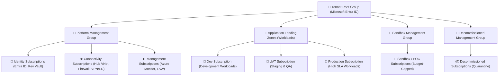
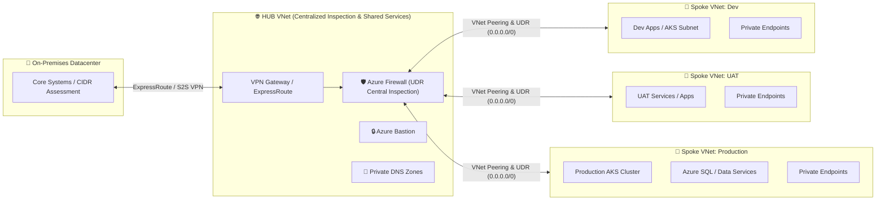
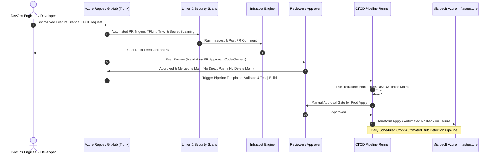
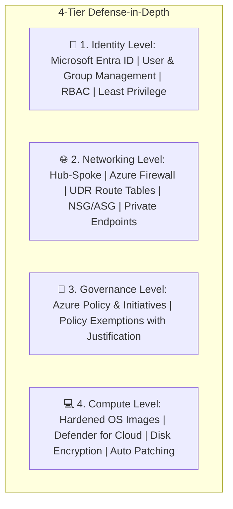

<!-- HERO HEADER BANNER -->

# ⚡ Simran Kamble
### **DevOps Engineer | Azure Cloud Infrastructure | CI/CD Automation | Kubernetes & Docker**

  <em>Hands-on DevOps Engineer with 3+ years of experience building, deploying, and maintaining resilient Microsoft Azure cloud infrastructure, automated CI/CD pipelines (Azure DevOps & GitHub Actions), Terraform IaC, and supporting 100+ application cloud migrations across Dev, UAT, and Production environments.</em>

<!-- SOCIAL & PROFESSIONAL BADGES -->

  
  
  
  

<!-- QUICK PILL BADGES -->

  
  
  
  
  
  
  

---

## 📌 Professional Summary

Enthusiastic and hands-on **DevOps Engineer** with **3+ years of experience** specializing in **Microsoft Azure cloud infrastructure provisioning & maintenance**, **CI/CD pipeline engineering**, **containerization (Docker & Kubernetes AKS)**, and **Infrastructure as Code (Terraform)**.

Proven hands-on experience supporting large-scale enterprise initiatives, including the **cloud migration of 100+ multi-tier applications** from On-Premises Datacenters to Azure across **Dev, UAT, and Production** subscriptions. Adept at implementing secure **Hub-and-Spoke virtual networks**, automated **Terraform modules with remote state and drift detection**, shift-left security scans in pipelines, and driving **FinOps cost optimization** while ensuring high availability and compliance.

### 🎯 Key Hands-on Competencies
- ☁️ **Azure Cloud Infrastructure**: Provisioning and managing multi-subscription Azure environments aligned with Microsoft Cloud Adoption Framework (CAF) guidelines.
- 🔁 **CI/CD Automation**: Creating end-to-end multi-stage build, test, and release pipelines using **Azure DevOps (Pipelines, Repos)** and **GitHub Actions**.
- 🛠️ **Infrastructure as Code**: Developing reusable, modular **Terraform** templates with remote backend state locking, least-privilege RBAC, and pipeline drift detection.
- 🐳 **Containers & Kubernetes (AKS)**: Containerizing applications with **Docker**, deploying and managing **Azure Kubernetes Service (AKS)** clusters with ingress controllers and Secrets Store CSI.
- 🚀 **100+ App Cloud Migration Support**: Executing discovery, pre-checklists, cutover sync, and post-migration validation for 100+ workloads across Dev, UAT, and Prod.
- 🔒 **Cloud Security & Governance**: Enforcing Azure Policy, RBAC groups, Microsoft Entra ID user/group management, and Defender for Cloud recommendations.
- 💰 **FinOps & Cost Optimization**: Implementing automated VM start/stop schedules, cleaning up unattached disks/orphaned resources, and optimizing Reserved Instances.
- 🔄 **High Availability & BCDR**: Configuring VMSS, LRS/ZRS/GRS storage redundancy, Azure Backup, and Azure Site Recovery (ASR) to meet target RTO/RPO SLAs.

---

## 🏛️ Azure Cloud Architecture & CAF Landing Zones

Hands-on implementation of structured multi-subscription landing zones aligned with the **Microsoft Cloud Adoption Framework (CAF)** lifecycle: **Plan ➔ Ready ➔ Adopt ➔ Govern ➔ Secure ➔ Manage**.

### 1. Management Group & Tenant Hierarchy

### 2. Tenant Hierarchy & Governance Best Practices
| Area | Implementation Details | Key Benefits |
| :--- | :--- | :--- |
| **Subscription Boundaries** | Segregated platform services from application landing zones across Dev, UAT, and Prod. | Reduced blast radius and clear environment isolation. |
| **Microsoft Entra ID & RBAC** | Configured security groups, user permissions, and role assignments mapped via Entra ID groups. | Principle of Least Privilege (PoLP); avoids individual user role clutter. |
| **Azure Policy & Initiatives** | Applied built-in and custom policy initiatives (e.g., allowed regions, mandatory tags, secure transfer). | Automated guardrails blocking non-compliant resource deployments. |
| **Policy Exemptions** | Documented business justifications, expiration dates, and tracked policy exemption scopes. | Controlled exceptions without compromising overall compliance posture. |
| **Subscription Lifecycle** | Standardized subscription onboarding and decommissioning procedures. | Fast workspace provisioning and safe cleanup of legacy assets. |

---

## 🌐 Hub-and-Spoke Networking Model

Hands-on design and maintenance of secure enterprise network connectivity connecting on-premises datacenters to Azure.

### Network Engineering Highlights
- **IP Address Management (IPAM) & CIDR Assessment**: Reviewed on-premises CIDR ranges to ensure non-overlapping address allocations for cloud VNets.
- **Hub VNet Setup**: Configured ExpressRoute/VPN Gateways, Azure Firewall, Azure Bastion, and centralized Private DNS Zones.
- **Spoke Peering & User Defined Routes (UDR)**: Configured bidirectional VNet peering and route tables routing `0.0.0.0/0` outbound traffic through Azure Firewall for centralized traffic inspection.
- **Private Endpoints**: Linked PaaS services (Azure Storage, Key Vault, Azure SQL, ACR) through Private Endpoints with Private DNS integration to eliminate internet exposure.
- **Controlled Egress**: Defined network and application firewall rules to restrict outbound traffic to approved FQDNs and ports.

---

## ⚡ DevSecOps & Infrastructure as Code (IaC)

### 1. Terraform Landing Zone Automation & Best Practices
- **Remote State Management**: Configured Azure Blob Storage backend with state locking (blob lease), encryption at rest, and strict RBAC access controls.
- **Reusable Modular Code**: Developed parameterized, modular Terraform code for VNets, subnets, NSGs, AKS, Storage Accounts, and VMSS.
- **Automated Quality & Security Checks**:
  - Code formatting and validation (`terraform fmt`, `terraform validate`, `tflint`).
  - Shift-left security scans using `tfsec` and `trivy` to detect vulnerabilities early.
  - Secret scanning with `GitGuardian` pre-commit and pipeline hooks.
  - Cost visibility using `Infracost` to estimate infrastructure changes on pull requests.
- **Pipeline Drift Detection**: Configured scheduled Azure DevOps / GitHub Actions pipelines running `terraform plan -detailed-exitcode` to detect portal out-of-band drifts.

### 2. CI/CD Pipeline Lifecycle (Azure DevOps & GitHub Actions)

### 3. Branching Strategy & Pipeline Governance
- **Trunk-Based Branching Strategy**: Developers work on short-lived feature branches (`feature/*`, `fix/*`) and integrate frequently into `main`.
- **Branch Policies**: Enforced branch protection on `main` — no direct pushes, no branch deletion, mandatory PR review (min 2 reviewers), and required status checks.
- **Modular Pipeline Templates**: Built reusable YAML templates for:
  - `Validate & Test`
  - `Build & Package`
  - `Deployment & Apply`
  - `Rollback on Failure`
- **Parallel Jobs**: Optimized execution speed using parallel pipeline stages for multi-environment checks.
- **Custom Data & Middleware Setup**: Provisioned VM software, packages, and middleware configurations via custom data scripts and Cloud-init.

---

## 🐳 Containerization & Kubernetes (AKS)

- **Docker Containerization**:
  - Authored clean, optimized multi-stage Dockerfiles.
  - Used lightweight base images (Alpine/Distroless) with non-root security standards.
  - Managed container images securely inside Azure Container Registry (ACR).
- **Azure Kubernetes Service (AKS)**:
  - Deployed and maintained AKS clusters with separate system and user node pools using Virtual Machine Scale Sets (VMSS).
  - Configured Azure CNI networking and pod security.
  - Set up Ingress Controllers (NGINX / AGIC) and automated SSL/TLS certificate renewals.
  - Integrated Azure Key Vault Secrets Store CSI Driver to securely mount secrets as volumes in pods.
  - Container image vulnerability scanning integrated into CI/CD pipelines with Trivy.

---

## 🚀 100+ Enterprise Application Cloud Migration

Hands-on contribution to migrating **100+ multi-tier workloads** from On-Premises Datacenters to Azure across **Dev, UAT, and Production** environments.

```mermaid
flowchart LR
    subgraph Phase1["1. Discovery & Assessment"]
        A1["Server & Application Inventory<br/>(Azure Migrate)"]
        A2["CIDR Assessment &<br/>Dependency Mapping"]
        A3["6R Strategy<br/>(Rehost, Replatform, Refactor)"]
    end

    subgraph Phase2["2. Landing Zone Readiness"]
        B1["Sub Provisioning<br/>(Dev / UAT / Prod)"]
        B2["Hub-Spoke Network &<br/>Firewall Rules"]
        B3["Entra ID & RBAC Setup"]
    end

    subgraph Phase3["3. Migration & Cutover"]
        C1["Data Replication Sync<br/>(ASR / DMS)"]
        C2["Pre-Cutover Checklist<br/>Validation"]
        C3["Cutover Window &<br/>DNS Switch"]
    end

    subgraph Phase4["4. Post-Cutover & Hypercare"]
        D1["Post-Cutover Checklist<br/>& Verification"]
        D2["Monitoring & Alerts<br/>Setup (Azure Monitor)"]
        D3["Hypercare Support &<br/>SOP Documentation"]
    end

    Phase1 --> Phase2 --> Phase3 --> Phase4
```

### Migration Checklists & Execution Governance
| Migration Phase | Action Items & Checklist | Verification Criteria |
| :--- | :--- | :--- |
| **Pre-Migration Checklist** | • Inventory discovery and dependency mapping via Azure Migrate. • Port readiness and network bandwidth check between On-Prem and Azure. • Target landing zone readiness (resource groups, subnets, Key Vaults). • Mock cutover execution in dedicated UAT subscriptions. | All dependencies identified, staging environment validated. |
| **During-Migration Checklist** | • Final delta data sync via Azure Site Recovery / Database Migration Service. • Graceful shutdown of on-premises application services. • Database cutover and data consistency validation. • DNS switchover to Azure public / private endpoints. | Data integrity verified, RPO within agreed window. |
| **Post-Migration Checklist** | • Application smoke testing and end-to-end functionality checks. • Backup policy enablement (Azure Backup / ASR protection). • Monitoring agents and Log Analytics data collection validation. • Sign-off from application owners. | Application healthy, zero critical errors in logs. |
| **Hypercare & Operations** | • 2-4 weeks post-cutover stabilization and issue resolution. • Performance tuning and resource rightsizing. • Knowledge Transfer (KT) and Standard Operating Procedures (SOPs) delivery. | Stable workload, smooth transition to BAU operations. |

---

## 🛡️ 4-Tier Security & Governance

- **Identity Level**: Microsoft Entra ID administration, RBAC group assignment, access reviews, and enforcing least privilege access.
- **Networking Level**: Zero public ingress to backend tiers; perimeter security through Azure Firewall, Network Security Groups (NSGs), and forced tunneling via UDRs.
- **Governance Level**: Continuous compliance enforcement with Azure Policy initiatives (e.g. tagging, location restrictions, encryption); structured exemption process with documented justification.
- **Compute Level**: Virtual Machine Scale Sets (VMSS), disk encryption at rest with customer-managed keys (CMK), Defender for Cloud security recommendations, and automated OS patching.

---

## 💰 FinOps & Cloud Cost Optimization

Implemented cost-conscious engineering practices to avoid cloud waste and maintain optimized budgets:

```mermaid
flowchart TD
    FinOps["💡 FinOps Cost Optimization Practices"]
    
    FinOps --> Waste["🗑️ Waste Cleanup"]
    FinOps --> Sizing["📐 Compute Rightsizing"]
    FinOps --> Commit["💳 Reservations & Lifecycle"]
    FinOps --> Telemetry["📊 Telemetry Tuning"]

    Waste --> W1["Identify and delete unattached managed disks"]
    Waste --> W2["Release orphaned public IPs and idle NICs"]
    Waste --> W3["Clean up obsolete snapshots and test resources"]

    Sizing --> S1["Downsize oversized compute based on CPU/RAM metrics"]
    Sizing --> S2["Automated Start/Stop runbooks for Dev & UAT VMs"]
    Sizing --> S3["Use VMSS autoscaling to match active traffic demand"]

    Commit --> C1["Leverage 1-Year / 3-Year Azure Reserved Instances (RI)"]
    Commit --> C2["Storage lifecycle: Hot ➔ Cool ➔ Cold ➔ Archive"]

    Telemetry --> T1["Tune Log Analytics ingestion and filter verbose logs"]
    Telemetry --> T2["Adjust backup retention periods to match compliance requirements"]
    Telemetry --> T3["Enforce cost allocation tags via Azure Policy"]
```

---

## 🔄 High Availability (HA) & Disaster Recovery (BCDR)

- **Storage Redundancy**:
  - **LRS (Locally Redundant)**: Cost-effective storage for non-critical Dev workloads.
  - **ZRS (Zone-Redundant)**: Replicated across availability zones for high-availability production data.
  - **GRS (Geo-Redundant)**: Replicated to secondary paired regions for disaster recovery and compliance backups.
- **Compute High Availability**:
  - Virtual Machine Scale Sets (VMSS) deployed across multiple Availability Zones with auto-healing and scaling rules.
- **Disaster Recovery Planning**:
  - Replicating workloads to secondary regions utilizing **Azure Site Recovery (ASR)**.
  - Adhering to target **Recovery Time Objectives (RTO)** and **Recovery Point Objectives (RPO)** validated through periodic failover drills.

---

## 📈 Monitoring & Observability

- **Azure Monitor & Log Analytics**: Centralized Log Analytics Workspaces (LAW) collecting diagnostic logs, performance counters, and platform metrics.
- **Application Insights**: Tracking application health, request rates, failure rates, and distributed tracing.
- **KQL Queries & Dashboards**: Writing custom Kusto Query Language (KQL) queries to build operational dashboards for infrastructure visibility.
- **Metric Alerts & Action Groups**: Configuring automated alerts for high CPU, disk space thresholds, network latency, and routing notifications to email and webhooks.

---

## 🤝 Project Delivery, Collaboration & Operational Governance

Working collaboratively with cross-functional development, QA, and operations teams:

- **Sprint Participation & Task Ownership**: Active participation in Scrum/Agile ceremonies, user story estimation, technical task execution, and sprint delivery.
- **RFP/RFI & Evaluation Support**: Supported technical evaluation matrices for assessing tooling capabilities, cloud architecture requirements, and operational readiness.
- **SOW & Acceptance Alignment**: Delivered infrastructure milestones according to Statement of Work (SOW) guidelines, acceptance criteria, and technical specifications.
- **Escalation Support**: Designed and followed structured escalation matrices with clear SLA guidelines for incident troubleshooting and resolution.
- **SOP Documentation & KT Transitions**: Authored detailed Standard Operating Procedures (SOPs), operational runbooks, and conducted Knowledge Transfer (KT) sessions for engineering teams.

---

## 🛠️ Technical Skills Ecosystem

| Domain | Technologies & Tools |
| :--- | :--- |
| **Cloud Platforms** |    |
| **CI/CD & DevSecOps** |     |
| **Infrastructure as Code** |     |
| **Containers & Orchestration** |     |
| **Networking & Perimeter** |      |
| **Security & Identity** |     |
| **Monitoring & BCDR** |     |
| **Scripting & Automation** |     |
| **Practices & Collaboration** |     |

---

## 📊 GitHub Activity & Insights

<table border="0">
  <tr>
    <td align="center">
      
    </td>
    <td align="center">
      
    </td>
  </tr>
  <tr>
    <td colspan="2" align="center">
      
    </td>
  </tr>
</table>

---

## 📬 Let's Connect & Collaborate!

I am always interested in discussing **DevOps practices**, **Azure Cloud Infrastructure**, **Terraform Automation**, **CI/CD Pipelines**, and **Kubernetes**.

&nbsp;

&nbsp;

  

DevOps Engineer (3+ Years) • Azure Cloud & Automation Specialist • © Simran Kamble

